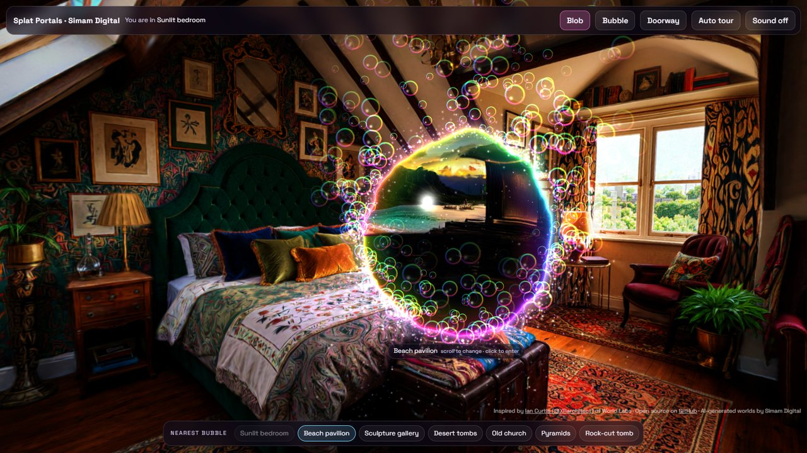
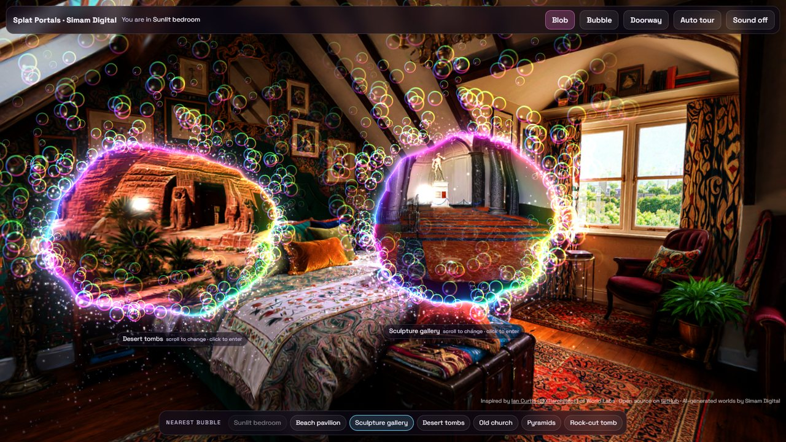
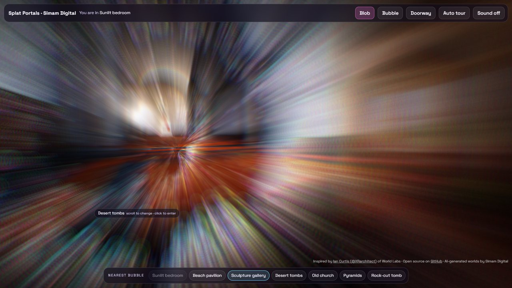

# Splat Portals

Floating soap-bubble portals between Gaussian splat worlds, in the browser.

A wobbling, rainbow-rimmed bubble floats in front of you. Inside it is another 3D world, with real parallax: move and the view through the bubble shifts like a window. **Scroll** on the bubble to change which world is inside. **Click** it and it grows until it fills your view, and you are standing in that world. **Click anywhere else** to blow another bubble to another world.

**Live demo:** https://lab.simamdigital.com/demos/portals



| Two bubbles, two worlds | Click to grow it |
|---|---|
|  |  |

Inspired by a portal effect shared by **Ian Curtis ([@XRarchitect](https://x.com/XRarchitect)) of World Labs**. Built by [Simam Digital](https://www.simamdigital.com): one HTML file, no build step, MIT licence.

## Run it

Eight worlds are included in `worlds/`, so it runs straight away. Serve the folder with any static server and open it:

```bash
npx serve .
```

| Do this | To |
|---|---|
| Scroll on a bubble (swipe on a phone) | Change the world inside it |
| Click a bubble (tap on a phone) | Grow it and step in |
| Click anywhere else | Open another bubble there (up to three) |
| Drag | Look around |
| Hold still (mouse or finger) | Walk forward; drag while holding to steer |
| W A S D, Q / E | Walk, and go down and up |
| Space | Step into the nearest bubble |
| Walk into a bubble | Go through it |
| Quality button | Auto, or pick Light, Balanced, High or Full yourself |

Add `?tour` to the URL for an automatic tour, `?quality=light` (or `balanced`, `high`, `full`) to fix the quality, and `?stats` to show the frame rate. To use your own worlds, see [worlds/README.md](worlds/README.md).

## What it does beyond the original

- **Sparks with real physics.** Thousands of sparks pour off the rim and are simulated in world space: they fall, drift, bounce off the actual walls, beds and floors of the 3D scan, split into smaller sparks when they hit hard, and settle as glowing dust.
- **A jiggly rim.** The edge is a ring of 40 springs. Moving the bubble, or brushing it with the cursor, sends waves round it, and the view inside ripples with them.
- **Bubbles behave like bubbles.** Each one sits on a soft spring, so it bobs, sways when you look around, squashes a little as it moves, and drifts back into view when you turn away.
- **Several bubbles at once,** each a window into a different world.
- **Three shapes:** an organic blob (the default), a round soap bubble, and a doorway with a ragged white-hot rim.
- **Bubbles bend light.** The view inside warps near the edge, like looking through a real soap film.
- **Soap bubbles and sparkles** drift off the rim; some sparkles fall and settle on the floor.
- **Worlds break up and form.** The world you leave scatters; the one you arrive in assembles out of a violet mist.
- **Walk through, too.** Walk up to a bubble and through it, with the keys or by holding still on a phone. Bubbles stay put while you walk towards them, and only drift back into view when you turn away.
- **A calm soundscape made in the browser.** Each world has its own slow ambient chords and air: the sea on the beach, wind in the desert, a low, dark room in the church. The bubbles whoosh as they move, panned to where they are, and you hear crackles as sparks hit, a wobble, chimes and a rush as you step through. There are no audio files.
- **Opens fast, and faster after the first time.** Each world first opens as a light version, a third of the size, and the full one swaps in behind it. World files are kept in the browser's cache storage, the rest download quietly in the background, and the worlds one scroll away are decoded ahead of time, so scrolling swaps instantly.
- **Starts somewhere calm:** a beach pavilion at sunset, with a quiet bay in the first bubble.
- **Runs on modest devices.** It picks a starting quality from the device's graphics chip, then watches the frame rate and steps up or down by itself.

## How it works

Everything runs on [three.js](https://threejs.org) and [Spark](https://sparkjs.dev), which draws the Gaussian splats.

### 1. Each world is its own scene

Every world gets its own `THREE.Scene` with its own `SparkRenderer`. Splats are sorted back to front for the camera that draws them, and several cameras are in play (yours, plus one per bubble), so each world keeps its own sort and nothing flickers.

The worlds come from different tools and are not all stored the same way up. Each entry in the `WORLDS` list has a `flip` flag for files stored y-down.

### 2. The view inside a bubble: a matching camera

Each bubble is a frame in your world: a position, turned to face you. The world inside has a matching frame at its own origin. Each frame:

```js
camB.matrixWorld = inverse(bubbleFrame) * camera.matrixWorld
```

That puts a camera in the other world exactly where you would be if the two worlds were joined at the bubble. The other world is drawn from it into an off-screen render target, one per bubble. Because that camera follows every move you make, the view inside has true parallax.

Splats in the other world that sit between that camera and the bubble would block the view. A clip plane in a Spark `dyno` shader, run per splat on the GPU, hides them:

```glsl
float side = dot(clip.xyz, center) + clip.w;
alpha *= 1.0 - smoothstep(-0.04, 0.0, side);
```

### 3. Drawing a bubble

Each bubble is one flat quad with a fragment shader. For each pixel it:

- measures the shape as a signed distance. The blob is a circle whose radius is pushed in and out by two layers of moving noise, so the outline breathes.
- inside the shape, samples the other world's image at this exact screen pixel (`gl_FragCoord.xy / resolution`). It is pushed outward a little near the edge for the lens bend.
- adds the soap film: a thin rainbow rim, a soft halo just outside, a tint just inside, and one bright highlight.

The sparkles and soap bubbles are a few thousand GPU points. Each point's whole life is a function of time and a random seed in the vertex shader: where it is born on the rim, how it swirls, whether it floats up as a bubble or falls to the floor. The soap bubbles are drawn as rainbow rings with a highlight.

### 4. Bubble physics

Each bubble has an anchor and a spring:

- **Drift.** The target wanders gently around the anchor.
- **Bounce.** Velocity is pulled toward the target and damped, so the bubble settles with a small bounce.
- **Sway.** Turning your head pushes it sideways.
- **Return.** If the anchor leaves your view, it eases back in front of you.
- **Squash.** The squash comes from the speed and is applied to the drawn surface only. The frame used for the camera mapping stays rigid, so the world inside never warps with the wobble.

### 5. Sparks that hit the room

When a world loads, every opaque splat centre is dropped into a 12 cm voxel grid, which gives a rough map of solid space (walls, furniture, floor) at almost no cost. Up to about 6,500 sparks are simulated on the CPU each frame with gravity and drag. When a spark's next position is solid, the surface normal comes from the neighbouring cells, and the spark bounces with friction. Hard hits split into two smaller sparks, and slow sparks stick and fade as dust. A few soap bubbles still drift up from the rim on the GPU.

### 6. The jiggle

The rim is a ring of 40 springs, each pulled back to rest and coupled to its neighbours, so a push at one point travels round as a wave. The bubble's own acceleration (it lags when it moves), small random pokes and the cursor all drive it. The spring values go to the shader as a uniform array and shape the outline; their total energy also drives a ripple in the view inside.

### 7. Sound

All synthesised with Web Audio, with no audio files. Everything goes through one bus with a gentle compressor and a shared reverb, made from a few seconds of decaying noise.

- **Ambient bed:** five soft voices play slow major-ninth chords, changing every 13 seconds, through a slowly moving low-pass filter. Underneath is filtered pink noise that swells like waves or wind. Each world sets its own key, brightness and kind of air. Now and then a quiet bell from the current chord sounds off to one side.
- **Movement:** a looping noise band whose loudness and pitch follow the fastest bubble's speed, plus how fast you turn and walk. It is panned to where that bubble is on screen.
- **Events:** a hum near bubbles, crackles when sparks hit (panned), a wobble when the rim is poked, a chime when a bubble opens, a blip and a swish when it changes world, and a long rush when you step in.

It starts on your first click or key press, pauses when the tab is hidden, and the top bar mutes it.

### 8. Stepping in

Clicking a bubble grows its shape well past the edges of the screen while you drift toward it. A radial motion blur, a colour split and a lens kick peak as it fills the view. At that moment the world you see is the other world, from the matching camera, so the swap is seamless: your position and facing are carried across with the same bubble transform, the other world becomes yours, and a new bubble forms ahead of you.

### Render order each frame

1. Each bubble's world, from its matching camera, into its own render target.
2. Your world, from your camera, into `rtMain`.
3. The bubbles (sampling their render targets) and their particles, on top.
4. The lens pass to the screen: motion blur, colour split, flash.

## Performance

Splats are expensive to fill, and every bubble draws a whole extra world each frame, so the page manages its own quality.

- **Starting level:** read from the graphics chip's name (`WEBGL_debug_renderer_info`), the device memory and the core count. Software rendering starts at Light, weak mobile chips at Balanced, phones and Intel graphics at High, and everything else at Full.
- **Four levels:**

| | Light | Balanced | High | Full |
|---|---|---|---|---|
| Render resolution | 55% | 75% | 90% | 100% |
| View inside a bubble | 50% | 60% | 80% | 100% |
| Bubbles at once | 1 | 2 | 3 | 3 |
| Spark rate | 30% | 55% | 80% | 100% |
| Splat footprint (`maxStdDev`) | 2.0 | 2.3 | 2.6 | √8 |
| Splat re-sort interval | 80 ms | 40 ms | 16 ms | every frame |

- **Governor:** it keeps a smoothed frame time and steps down after 1.5 seconds below about 33 fps, or 0.6 seconds below 20 fps. It steps back up after 6 seconds above about 52 fps. If a level has had to be abandoned twice, it stops climbing back to it, so it never flips back and forth. Frames while a world is loading are ignored.
- **Cheaper effects:** the lens pass takes a single sample when nothing is blurring, instead of 84, and fewer samples on lighter levels. The glow on the world around the bubbles is recomputed every 2nd or 4th frame on lighter levels. On Light, each bubble's world redraws every other frame.
- **Light first:** each world has a light version in `worlds/lite/`, about 8 MB instead of 24 MB. It has no view-dependent colour and 30% of the splats, made with `splat-transform world.sog -H 0 -F 30% lite/world.sog`. A world opens from it unless the full file is already on disk. The full file then downloads and decodes in the background, one world at a time, and swaps in without a visible jump. On the Light quality level the light version stays.
- **Loading:** world files go into Cache Storage the first time they download, so later visits open from disk. Six seconds after the start, the other worlds download one at a time in the background. This doesn't happen on Save-Data or 2G/3G connections, and phones fetch only the next few. The worlds one scroll away from each bubble (two on Full, one on Balanced and High, none on Light) are decoded onto the GPU ahead of time; everything else is freed. The collision grid for sparks is built only when you enter a world, so pre-decoding never stalls the view.
- **Graceful failure:** if WebGL 2 is missing or the graphics driver resets, the page says so in plain words instead of showing a blank screen.

Measured at 1600×900 on an RTX 4070: 60 fps at every level with one bubble. With three bubbles, 48 fps at Full and 58 fps at Light.

## Notes

- Each bubble draws a whole extra world every frame, so the number of bubbles is capped: three on desktop, two on phones.
- Worlds load as you need them, and ones you have left behind are freed so the GPU stays light.
- Reduced motion is respected: shorter transitions and very little blur.

## Credits and licence

- Code: MIT, see [LICENSE](LICENSE). Built by Simam Digital Ltd.
- The eight worlds are AI-generated Gaussian splats made by Simam Digital, shared under the same licence.
- Libraries: [three.js](https://threejs.org) and [Spark](https://sparkjs.dev), both MIT, loaded from a CDN.
- Inspired by a portal effect shared by Ian Curtis ([@XRarchitect](https://x.com/XRarchitect)) of World Labs.
