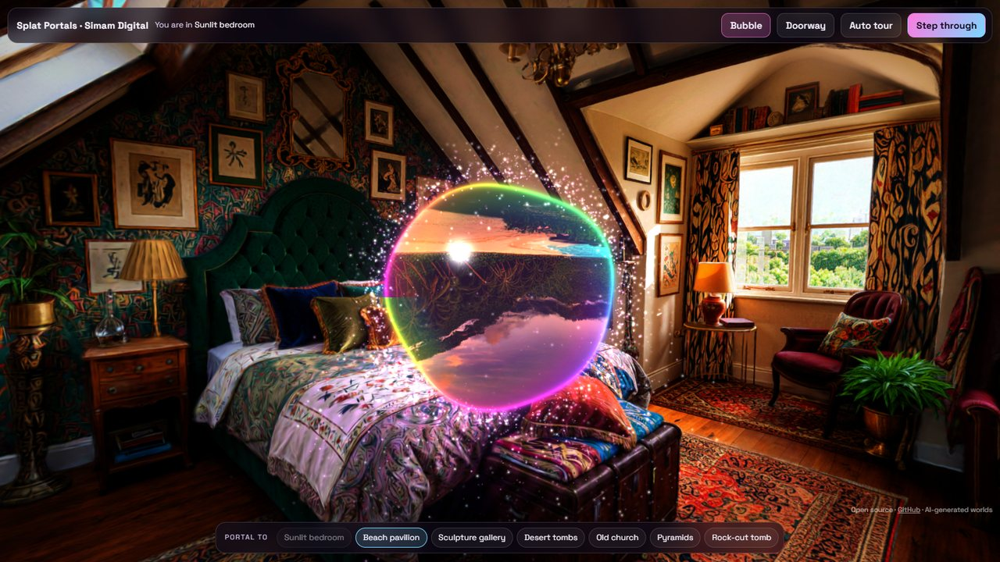
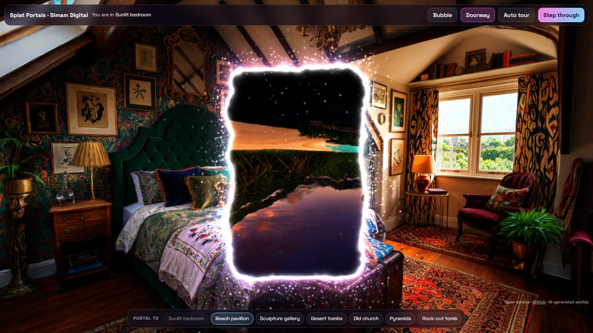
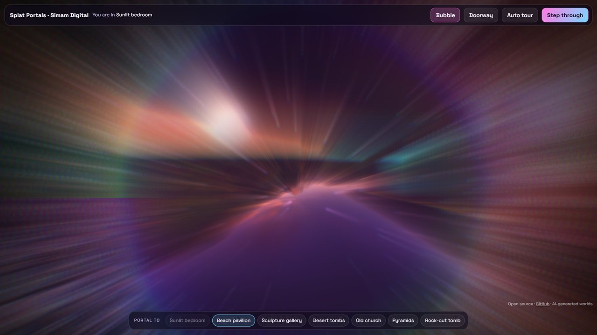

# Splat Portals

Walk through portals between Gaussian splat worlds, in the browser.

A soap-bubble or doorway portal floats in front of you. Through it you see a different 3D world, with real parallax: move your head and the view through the portal shifts the way a window would. Walk into it (or press **Space**) and a motion-blur jump carries you through. The world you leave breaks into sparkles, and a new portal to the next world forms ahead of you.

**Live demo:** https://lab.simamdigital.com/demos/portals



| Doorway portal | The jump |
|---|---|
|  |  |

Inspired by a portal effect shared by **Ian Curtis ([@XRarchitect](https://x.com/XRarchitect)) of World Labs**. Built by [Simam Digital](https://www.simamdigital.com) in one sitting: one HTML file, no build step, MIT licence.

## What it adds

- **Two-sided portals.** Walk round the back of a portal and you see the other world from the other side, as if the two worlds really were joined there.
- **Put a portal anywhere.** Click a wall or the floor and a portal opens on that spot.
- **A bubble that bends light.** The view inside the bubble warps near its edge, like looking through a real soap bubble, and the bubble bobs gently in the air.
- **A motion-blur jump.** Radial blur, a colour split and a lens kick as you cross.
- **Worlds that break up and form.** The world you leave scatters into sparkles; the world you arrive in assembles out of a violet mist.
- **A rim that lights the room.** Splats near the portal pick up a violet shimmer.
- **Sound, made in the browser.** A whoosh when you jump and a chime when a portal opens, with no audio files.

## Run it

Seven worlds are included in `worlds/`, so it runs straight away. Serve the folder with any static server and open it:

```bash
npx serve .
```

Controls: drag to look, **W A S D** to walk, **Q / E** down and up, **click** a surface to open a portal there, **Space** to step through, **1 to 7** to pick the next world. Add `?tour` to the URL for an automatic tour, or `?shape=door` to start with the doorway.

To use your own worlds, put the files in `worlds/` and edit the `WORLDS` list near the top of the script in `index.html` (see [worlds/README.md](worlds/README.md)).

## How it works

Everything runs on [three.js](https://threejs.org) and [Spark](https://sparkjs.dev), which draws the Gaussian splats.

### 1. Each world is its own scene

Every world gets its own `THREE.Scene` with its own `SparkRenderer`. Splats have to be sorted back to front for the camera that draws them, and there are two cameras in play (yours, and the one looking through the portal). One renderer per world means each world keeps its own sort, so neither flickers.

The splat files used here start at the origin looking down **-z**. They are stored y-down, so each mesh is turned 180 degrees about the x axis when it loads.

### 2. The view through the portal: a matching camera

The portal is a frame in your world: a position, and a facing direction. The next world has a matching frame at its own origin. Each frame:

```js
camB.matrixWorld = inverse(portalFrame) * camera.matrixWorld
```

That puts a second camera in the next world exactly where you would be if your world and the next one were glued together at the portal. The next world is drawn from that camera into an off-screen render target. Because the second camera follows your every move, the view through the portal has true parallax, not a flat picture.

Splats in the next world that sit between that camera and the portal would block the view, so a clip plane hides everything on the near side of the portal. That is a few lines in a Spark `dyno` shader, run per splat on the GPU:

```glsl
float side = dot(clip.xyz, center) + clip.w;
alpha *= 1.0 - smoothstep(-0.04, 0.0, side);
```

### 3. Drawing the portal itself

The portal is one flat quad with a fragment shader. For each pixel it:

- works out the shape as a signed distance: a wobbling circle for the bubble, a rounded box with animated noise on the edge for the doorway;
- inside the shape, samples the off-screen image of the next world at this exact screen pixel (`gl_FragCoord.xy / resolution`), so the other world lines up perfectly behind the opening;
- adds the rim: a thin-film rainbow and one bright highlight for the bubble, or a white-hot core fading to violet and blue for the doorway.

The sparkles are about 3,400 GPU points with no CPU work. Each point's whole life (where it is born on the rim, how it swirls, whether it spills down and settles on the floor) is a function of time and a random seed in the vertex shader.

Splats in your own world that sit close to the portal ring get a violet shimmer from the same per-splat shader, so the portal seems to light the room around it.

The portal is two-sided. When you walk behind it, the clip plane in the next world flips, so you see that world from the other side. Inside the bubble, the screen position used to sample the other world is pushed outward near the edge, which gives a soft lens bend.

### 4. Going through

Each frame, your position is converted into the portal's local space. When it crosses the portal plane inside the opening (going from in front to behind), the worlds swap:

- your position and facing are carried across with the same portal transform, so there is no jump in the picture;
- the world you were looking into becomes the world you stand in;
- a new portal to the next world is placed ahead of you and springs open.

**Step through** flies you along a path through the portal centre in portal space, so the path stays correct on both sides of the swap.

### 5. The jump effect

Everything is drawn to one more render target, then a final full-screen pass adds:

- a radial motion blur centred on the portal (28 samples along the line to the centre);
- a red and blue split that grows with the blur, like a lens at speed;
- a vignette and a short violet-white flash on arrival.

The blur and a field-of-view kick (70 to 96 degrees) both peak as you cross. The world you leave breaks apart: its splats drift outward and shrink, again in the per-splat shader.

## Render order each frame

1. The next world, from the matching camera, into `rtB`.
2. Your world, from your camera, into `rtMain`.
3. The portal quad (sampling `rtB`) and the sparkles, on top, into `rtMain`.
4. The lens pass: `rtMain` to the screen with blur, colour split and flash.

## Notes

- Big worlds (2 million splats each) mean two are on the GPU at once. It runs smoothly on a desktop GPU. Phones work, but expect lower frame rates.
- The worlds load one at a time, and the next one is fetched in the background while you look around.
- Reduced motion is respected: the jump becomes a short cut with very little blur.

## Credits and licence

- Code: MIT, see [LICENSE](LICENSE). Built by Simam Digital Ltd.
- Libraries: [three.js](https://threejs.org) (MIT) and [Spark](https://sparkjs.dev) (MIT), loaded from a CDN.
- The seven worlds are AI-generated Gaussian splats made by Simam Digital, shared under the same MIT licence.
- Inspired by a portal effect shared by Ian Curtis ([@XRarchitect](https://x.com/XRarchitect)) of World Labs.
